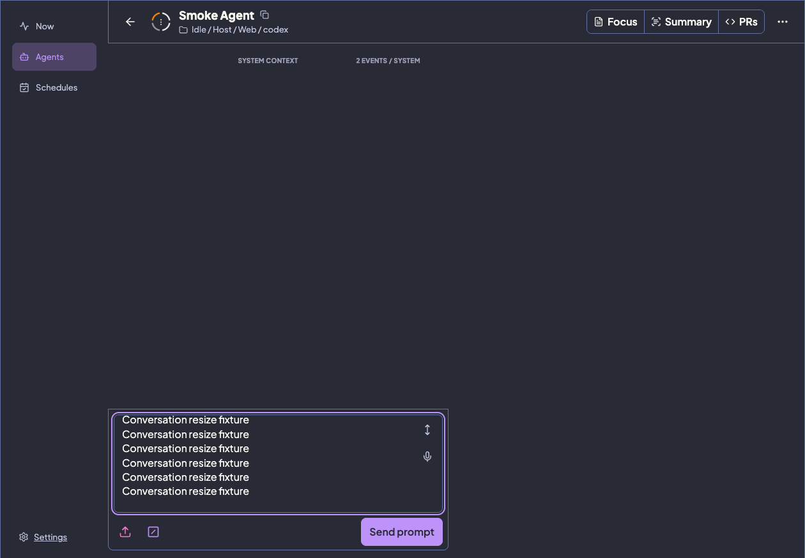
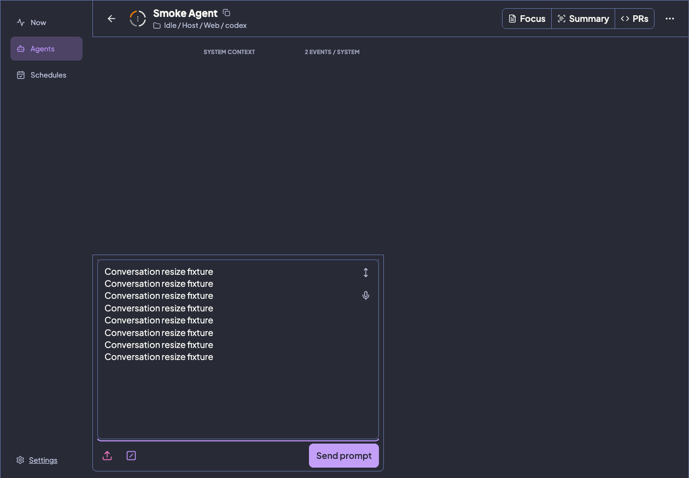
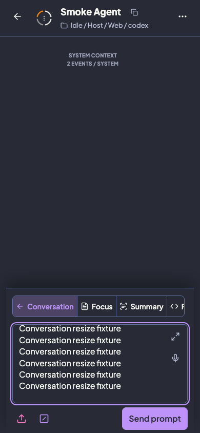
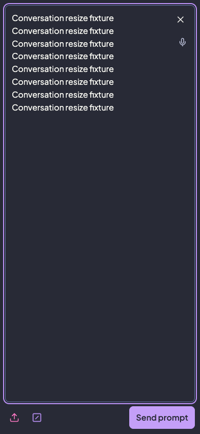
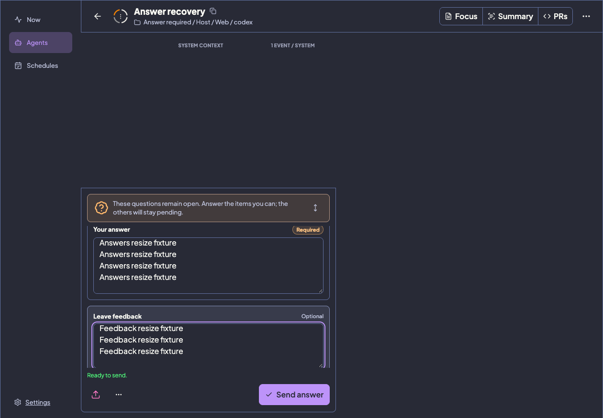
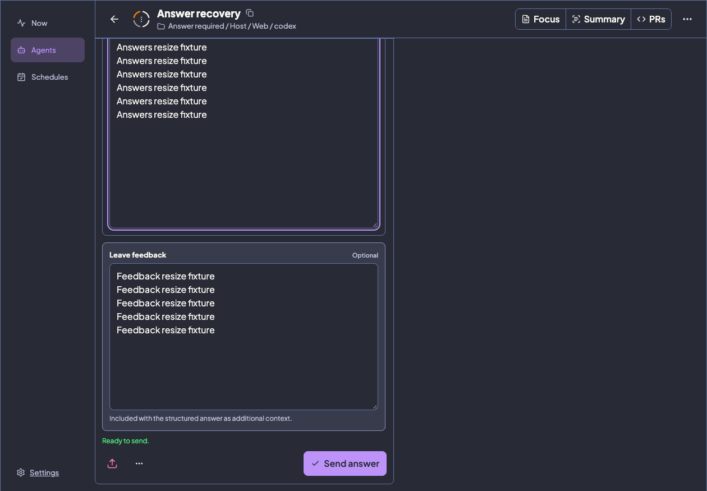
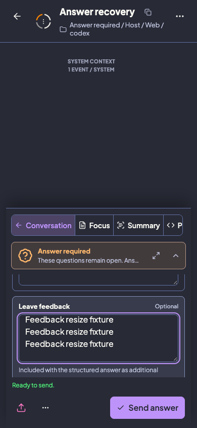
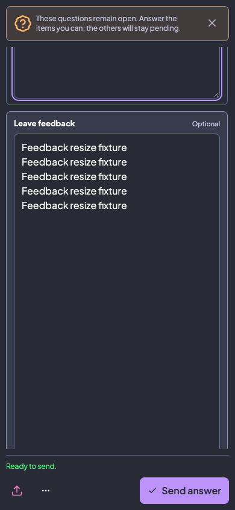

# Card 922 textarea resize evidence

The before screenshots and measurements use the unmodified `origin/main` UI. The after screenshots use the fix on `fix/card-922-textarea-resize`. The browser fixture ran against a throwaway Remote UI server with temporary config and logs.

## Conversation

On desktop, the panel-height action changed the prompt textarea from 154.3 px to 66.8 px. The dock had only 134.8 px of height. After the fix, the dock has a 397.3 px panel track and the prompt textarea fills 329.3 px. The send control stays visible and receives pointer input.

On mobile, the full-screen editor uses 772 px of the 844 px viewport. Its send control remains visible.

### Desktop

| Before | After |
| --- | --- |
|  |  |

### Mobile

| Before | After |
| --- | --- |
|  |  |

## Answers

The feedback textarea had a computed maximum height of 210 px on desktop and 202.6 px on mobile. The expanded form now removes that cap. Repeated native drag steps reached 262 px on desktop and 621 px on mobile. The submit control remains reachable after scrolling the desktop dock or the mobile form fields.

### Desktop

| Before | After maximum drag |
| --- | --- |
|  |  |

### Mobile

| Before | After maximum drag |
| --- | --- |
|  |  |

Full geometry is in [before measurements](measurements-before.json) and [after measurements](measurements-after.json).
