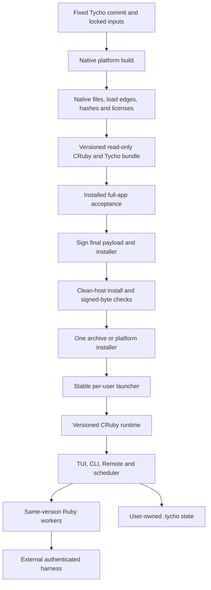

# Tycho distribution plan — Card 329

Date: 2026-10-17. Status: proposal for operator and independent review. This document does not approve implementation or a new support promise.

Request: [Card 329](https://fizzy.startkit.tech/1/cards/329). Analysis used GPT-6 Astra with high reasoning under Codex. Source baseline: [Tycho commit 8d813dca497fe9e106d0a679ee2f74849239c54c](https://github.com/firewalker06/tycho/tree/8d813dca497fe9e106d0a679ee2f74849239c54c). Local card text: [operator requirements](/Users/didik/.tycho/artifacts/cards-327-329/card-329.txt).

## What, why, and recommendation

Tycho can plausibly ship without a user-installed Ruby, Bundler, Go, or compiler. The lowest-risk route is a **self-contained CRuby directory bundle for each supported platform**, delivered as one archive or installer. Keep Homebrew supported. First prove Apple Silicon macOS and x86-64 glibc Linux. Validate the same Linux build under WSL2. Treat native Windows as a separate portability project.

Do not promise one executable that works on every OS and CPU. Tycho loads CRuby native extensions, including Charm Go archives through C bridges. It also starts separate Ruby workers, manages POSIX process groups, reads files beside its source, and writes durable state outside its installation. An installer can carry these parts. It cannot make these platform contracts disappear.

Use two short candidate experiments after operator approval:

1. Build a relocatable CRuby bundle. Use a controlled runtime build and an explicit file manifest. OCRAN directory output is a candidate helper, subject to the same tests.
2. Compare a pinned Tebako v2 **fat** package with that working bundle. Test the actual Tycho process tree and assets. Reject the candidate if it needs a host Ruby, a first-run runtime download, unsafe loader inheritance, broad signing exceptions, or major app changes.

Prefer the directory bundle if both routes pass. It exposes the native library set, keeps real paths for child Ruby commands, and makes signing and recovery easier to inspect. Adopt a packed executable only if it gives a measured user benefit and passes every gate below. An extraction wrapper is another delivery format for the bundle; it is not a different runtime architecture.

No product code, dependencies, user config, service, release, tap, or installer was changed for this report. No packaging toolchain was downloaded or run. The report records source inspection, official documentation, GitHub metadata, and bounded local Ruby/native-file metadata. Product tests and exact-head PR signoff are recorded by the coordinating agent. No screenshot is needed: this change has no UI behavior or asset change.

## Terms and scope

| Term | Meaning for this plan | What it does not prove |
| --- | --- | --- |
| Single-file download | One archive, executable wrapper, or installer to download | One file at runtime; no extraction; offline operation |
| Single executable | One OS-loadable entry file; it may embed or extract other files | Static linkage; no writable cache; child-process support |
| Self-contained bundle | Tycho, CRuby, gems, non-system native libraries, assets, licenses, and launcher in one versioned directory | Included external harnesses, credentials, Tailscale, or every OS library |
| Platform installer | Installs a tested bundle, records ownership, sets an optional PATH entry, and supports removal | Native app portability or an OS service manager |
| Universal macOS binary | Mach-O with more than one CPU slice, where every required native component also has the needed slice | Linux/Windows support; proof that Intel Tycho is supported |
| Full app support | TUI, CLI, Remote UI, persistence, agent lifecycle, hooks, scheduler, and update/recovery contracts pass | Every third-party harness version, terminal app, or network policy |

The first target is desktop/server operating systems used by Tycho. Mobile browsers remain Remote UI clients. A mobile-native app, embedded target, BSD port, App Store sandbox, bundled provider credentials, and a replacement TUI are new product scope. Do not add them to a packaging card.

## Evidence rules

Facts below refer to the fixed Tycho baseline unless stated otherwise. Source links name the file and start line; the text states the relevant range. External pages were checked on 2026-10-17. A project README claim is evidence of the tool's stated contract, not proof that it runs Tycho. Repository head facts are pinned where practical. No candidate received a Tycho runtime pass in this investigation.

Charm source links use the commits resolved from the locked release tags: Bubbletea v0.1.3, Lipgloss v0.2.2, and Glamour v0.2.2. They do not use each repository's latest head. The local inspection covered the installed ARM Darwin gem loaders/build scripts and selected native files. It did not establish byte identity or successful execution for every released platform gem. A later build must hash and audit the actual downloaded gem/archive bytes for each target.

The supplied memory about the September 11 Spinel rejection is historical context. The current repository records the same decision in [PROJECT_STATUS.md, line 80](https://github.com/firewalker06/tycho/blob/8d813dca497fe9e106d0a679ee2f74849239c54c/docs/PROJECT_STATUS.md#L80). The current Spinel source was checked separately below. The old result is not used to reject all future compilers or all packaging tools.

## Current dependency and runtime audit

| Surface | Evidence in current source | Distribution consequence |
| --- | --- | --- |
| Entry and CRuby boot | [bin/tycho, lines 1–58](https://github.com/firewalker06/tycho/blob/8d813dca497fe9e106d0a679ee2f74849239c54c/bin/tycho#L1): Ruby shebang; macOS hard-link/copy of `RbConfig.ruby` to user logs; re-exec with a script path; optional source Gemfile/Bundler setup; dotenv loading | A packed entry cannot assume `RbConfig.ruby` is a normal interpreter or that `__FILE__` is visible to a new process. The macOS process-name copy needs a package-aware contract. Copying a runtime with relative library paths may break its loader. |
| Declared Ruby/gems | [Gemfile, lines 3–19](https://github.com/firewalker06/tycho/blob/8d813dca497fe9e106d0a679ee2f74849239c54c/Gemfile#L3), [Gemfile.lock](https://github.com/firewalker06/tycho/blob/8d813dca497fe9e106d0a679ee2f74849239c54c/Gemfile.lock), and [hq.gemspec, lines 13–60](https://github.com/firewalker06/tycho/blob/8d813dca497fe9e106d0a679ee2f74849239c54c/hq.gemspec#L13) | Ruby `>=3.2` is a declared lower bound, not a release qualification. Lock metadata says Ruby 3.4.7 / Bundler 2.7.2. It does not prove this is the installed interpreter. The gemspec has broad dependency ranges; release builds need a controlled resolution, not an unconstrained second gem installation. |
| Charm native stack | Lock: Bubbletea 0.1.3, Lipgloss 0.2.2, Glamour 0.2.2; Bubbles/Harmonica 0.1.1. The lock lists Darwin ARM/Intel and GNU/musl Linux ARM, ARM64, x86, x86-64 variants, plus source `ruby` | Native gem availability is one input. It does not establish Tycho support, Ruby ABI compatibility, or OS minimums. Go is a build input, not a managed runtime command. |
| Charm load/build contract | [Bubbletea loader](https://github.com/marcoroth/bubbletea-ruby/blob/2b165b4e1961896a3967556411a56b862cc60aed/lib/bubbletea.rb#L5) selects a Ruby major/minor native extension. [Bubbletea extconf, lines 28–68](https://github.com/marcoroth/bubbletea-ruby/blob/2b165b4e1961896a3967556411a56b862cc60aed/ext/bubbletea/extconf.rb#L28) requires a Go archive, then applies Darwin/Linux linker rules. [Lipgloss extconf](https://github.com/marcoroth/lipgloss-ruby/blob/67016fc73015627a2d44b995965e4faa26d76dc8/ext/lipgloss/extconf.rb) and [Glamour extconf](https://github.com/marcoroth/glamour-ruby/blob/a1fcb258409576fee0b3cb61c57aabbb2d3022be/ext/glamour/extconf.rb) are separate build inputs | Audit all three archives and selected extensions. A Windows name in platform detection is insufficient: Bubbletea has no corresponding Windows link branch here. Windows lock artifacts are absent. A successful upstream Go Windows build would not establish Ruby bridge support. |
| Intel native workaround | [lib/lipgloss.rb, lines 9–33](https://github.com/firewalker06/tycho/blob/8d813dca497fe9e106d0a679ee2f74849239c54c/lib/lipgloss.rb#L9) chooses the Ruby compatibility backend on Intel Darwin and uses `Gem::Specification` to find native Lipgloss elsewhere | Preserve this override and gem metadata. Do not merge all Charm runtimes into one new executable without testing their isolation. Intel source support does not restore Intel bottle support. |
| Other native components | Lock includes ERB 6.0.4 and OpenSSL 4.0.1; the local gem specifications declare native build scripts. [constants.rb, lines 3–12](https://github.com/firewalker06/tycho/blob/8d813dca497fe9e106d0a679ee2f74849239c54c/lib/hq/domain/constants.rb#L3) loads JSON, OpenSSL and other standard libraries; Remote server loads socket | Include runtime standard/default gems and their native extensions, not just direct gems. Inventory JSON, Psych/libyaml, IO console, socket, zlib, OpenSSL/provider modules, and any other shipped or loaded extension. Include libffi/GMP only where the selected runtime links them. Include CA certificates and timezone requirements. |
| TUI and input | [cli.rb, lines 19–31](https://github.com/firewalker06/tycho/blob/8d813dca497fe9e106d0a679ee2f74849239c54c/lib/hq/cli.rb#L19), [bubbletea_input.rb, lines 6–42](https://github.com/firewalker06/tycho/blob/8d813dca497fe9e106d0a679ee2f74849239c54c/lib/hq/bubbletea_input.rb#L6) | Requires a real terminal path, alt screen, resize/control keys, and the raw/bracketed-paste shim. Noninteractive version output cannot qualify this path. |
| Glamour worker | [chat_rendering.rb, lines 319–338](https://github.com/firewalker06/tycho/blob/8d813dca497fe9e106d0a679ee2f74849239c54c/lib/hq/ui/rendering/chat_rendering.rb#L319), [bin/worker, lines 4–16](https://github.com/firewalker06/tycho/blob/8d813dca497fe9e106d0a679ee2f74849239c54c/bin/worker#L4) | `IO.popen` starts `RbConfig.ruby` and a sibling worker script. Worker always requires Bundler. Keep it in a separate process. Include its gems even when a packager's discovery run never opens chat. |
| Managed runner and callback | [managed_agent.rb, lines 1353–1371](https://github.com/firewalker06/tycho/blob/8d813dca497fe9e106d0a679ee2f74849239c54c/lib/hq/domain/managed_agent.rb#L1353), [Ruby resolution, lines 1989–1998](https://github.com/firewalker06/tycho/blob/8d813dca497fe9e106d0a679ee2f74849239c54c/lib/hq/domain/managed_agent.rb#L1989), [correction runner, lines 2069–2100](https://github.com/firewalker06/tycho/blob/8d813dca497fe9e106d0a679ee2f74849239c54c/lib/hq/domain/managed_agent.rb#L2069), [finalize callback, lines 2322–2326](https://github.com/firewalker06/tycho/blob/8d813dca497fe9e106d0a679ee2f74849239c54c/lib/hq/domain/managed_agent.rb#L2322) | Needs child Ruby with `--disable-gems -e`; correction adds `-I/-r`; recorder is required by path; finalize invokes Ruby plus Tycho script. A fallback to host `ruby` would violate self-containment. Versioned runtime files must remain while runs use them. |
| Process groups, signals, pipes | [managed_agent.rb, lines 2791–2812](https://github.com/firewalker06/tycho/blob/8d813dca497fe9e106d0a679ee2f74849239c54c/lib/hq/domain/managed_agent.rb#L2791), [agent_stream_recorder.rb](https://github.com/firewalker06/tycho/blob/8d813dca497fe9e106d0a679ee2f74849239c54c/lib/hq/domain/agent_stream_recorder.rb#L25), [command_runner.rb](https://github.com/firewalker06/tycho/blob/8d813dca497fe9e106d0a679ee2f74849239c54c/lib/hq/domain/command_runner.rb#L20), [hooks/shell_runner.rb](https://github.com/firewalker06/tycho/blob/8d813dca497fe9e106d0a679ee2f74849239c54c/lib/hq/hooks/shell_runner.rb#L36) | `pgroup: true`, negative PID signals, TERM/KILL, liveness checks and process wait are core contracts. Current managed execution uses pipes/files, not a Tycho-owned PTY. An exact-word search found no `PTY`/`pty` use under `lib` or `bin`. Terminal libraries can still need terminal OS APIs. |
| External harness and environment | [executable_resolver.rb, lines 13–69](https://github.com/firewalker06/tycho/blob/8d813dca497fe9e106d0a679ee2f74849239c54c/lib/hq/domain/executable_resolver.rb#L13), [harness_execution.rb, lines 5–30](https://github.com/firewalker06/tycho/blob/8d813dca497fe9e106d0a679ee2f74849239c54c/lib/hq/domain/harness_execution.rb#L5) | Codex, Claude, OpenCode, Pi and configured wrappers remain separate installations with their own auth. Built-in overrides and fallback paths must work. Keep Ruby/Bundler state and server-only tokens out of harness children. A packager preload variable is a new environment input that needs a deliberate child-boundary policy. |
| Other commands | [project.rb, lines 112–127](https://github.com/firewalker06/tycho/blob/8d813dca497fe9e106d0a679ee2f74849239c54c/lib/hq/domain/project.rb#L112), [executable_resolver.rb, lines 13–19](https://github.com/firewalker06/tycho/blob/8d813dca497fe9e106d0a679ee2f74849239c54c/lib/hq/domain/executable_resolver.rb#L13), [app.rb, lines 1802–1888](https://github.com/firewalker06/tycho/blob/8d813dca497fe9e106d0a679ee2f74849239c54c/lib/hq/app.rb#L1802) | Git metadata/diffs and GitHub CLI features need those tools/auth. Terminal opening uses `osascript`, `open`, or WezTerm plus `sh -lc`; it is not a generic Linux/Windows implementation. Missing optional commands need explicit capability reporting. Packaging must not silently install them. |
| Scheduler and services | [schedule_daemon_supervisor.rb, lines 128–163](https://github.com/firewalker06/tycho/blob/8d813dca497fe9e106d0a679ee2f74849239c54c/lib/hq/domain/schedule_daemon_supervisor.rb#L128), [remote_server.rb, lines 245–254](https://github.com/firewalker06/tycho/blob/8d813dca497fe9e106d0a679ee2f74849239c54c/lib/hq/remote_server.rb#L245) | Scheduler spawns Ruby plus `bin/tycho`, detaches, and stores a heartbeat. Remote daemon uses `Process.daemon`. No launchd/systemd service definition was found in app/bin scope. A boot/login service installer is additional integration, not existing parity. |
| Remote server and assets | [remote_server.rb, lines 110–139](https://github.com/firewalker06/tycho/blob/8d813dca497fe9e106d0a679ee2f74849239c54c/lib/hq/remote_server.rb#L110), [remote_ui.rb, lines 9–71](https://github.com/firewalker06/tycho/blob/8d813dca497fe9e106d0a679ee2f74849239c54c/lib/hq/remote_ui.rb#L9), [gemspec asset list, lines 25–43](https://github.com/firewalker06/tycho/blob/8d813dca497fe9e106d0a679ee2f74849239c54c/hq.gemspec#L25) | Ruby TCP server, threads and signals; ERB, CSS, JS, service worker, fonts, logos and licenses read from disk and hashed at server start. No Node runtime is needed to serve these files. Browser test tooling is a build/test dependency. Include config examples, result schema, skill manifest and skill payloads. |
| Tailscale/network/auth | [tailscale.rb, lines 34–49](https://github.com/firewalker06/tycho/blob/8d813dca497fe9e106d0a679ee2f74849239c54c/lib/hq/tailscale.rb#L34), [serve_command.rb, lines 63–81](https://github.com/firewalker06/tycho/blob/8d813dca497fe9e106d0a679ee2f74849239c54c/lib/hq/serve_command.rb#L63), [remote_server.rb, lines 703–712](https://github.com/firewalker06/tycho/blob/8d813dca497fe9e106d0a679ee2f74849239c54c/lib/hq/remote_server.rb#L703) | Tailscale is an optional external CLI/daemon. Detection chooses the bind/URL path; HTTPS Serve is separate. Current code warns for a missing token on non-loopback but does not reject it. Do not describe it as enforced auth. An installer should not auto-start an exposed server. Any change to enforce tokens is a separate security behavior card. |
| Persistent data and SQLite | [constants.rb, lines 117–146](https://github.com/firewalker06/tycho/blob/8d813dca497fe9e106d0a679ee2f74849239c54c/lib/hq/domain/constants.rb#L117), [file_store.rb, lines 26–94](https://github.com/firewalker06/tycho/blob/8d813dca497fe9e106d0a679ee2f74849239c54c/lib/hq/domain/file_store.rb#L26), [usage_metrics/store.rb, lines 19–38](https://github.com/firewalker06/tycho/blob/8d813dca497fe9e106d0a679ee2f74849239c54c/lib/hq/domain/usage_metrics/store.rb#L19), [agent_store lock](https://github.com/firewalker06/tycho/blob/8d813dca497fe9e106d0a679ee2f74849239c54c/lib/hq/domain/agent_store.rb#L1515) | App state is JSON/YAML/JSONL and files with locks, temp writes, rename, backups and fsync. No SQLite gem is in the Gemfile/lock/gemspec; no exact `sqlite`/`sqlite3` match was found under `lib`/`bin`. Do not add SQLite to the package dependency claim. Harness-owned SQLite databases, if any, belong to those external tools. |
| Writable paths and secrets | [constants.rb, lines 30–70](https://github.com/firewalker06/tycho/blob/8d813dca497fe9e106d0a679ee2f74849239c54c/lib/hq/domain/constants.rb#L30), [dotenv_loader.rb, lines 7–21](https://github.com/firewalker06/tycho/blob/8d813dca497fe9e106d0a679ee2f74849239c54c/lib/hq/dotenv_loader.rb#L7), [remote_credential_store.rb, lines 17–22 and 123–142](https://github.com/firewalker06/tycho/blob/8d813dca497fe9e106d0a679ee2f74849239c54c/lib/hq/domain/remote_credential_store.rb#L17), [web_push_notifier.rb, lines 203–227](https://github.com/firewalker06/tycho/blob/8d813dca497fe9e106d0a679ee2f74849239c54c/lib/hq/domain/web_push_notifier.rb#L203) | Defaults are `~/.tycho/config`, logs, schedules and workspaces; overrides must survive. `.env`, Remote credentials, VAPID private keys, prompts and logs are user state. Never gather them from a build host. Credential file mode is 0600; Windows needs an ACL-equivalent proof, not a claim that chmod solves it. |
| Setup, migration and update | [bin/setup](https://github.com/firewalker06/tycho/blob/8d813dca497fe9e106d0a679ee2f74849239c54c/bin/setup#L1), [constants.rb, lines 73–114](https://github.com/firewalker06/tycho/blob/8d813dca497fe9e106d0a679ee2f74849239c54c/lib/hq/domain/constants.rb#L73), [tycho_updater.rb, lines 19–66](https://github.com/firewalker06/tycho/blob/8d813dca497fe9e106d0a679ee2f74849239c54c/lib/hq/domain/tycho_updater.rb#L19), [Remote update, lines 608–611](https://github.com/firewalker06/tycho/blob/8d813dca497fe9e106d0a679ee2f74849239c54c/lib/hq/remote_server.rb#L608) | Setup is Bash/source-install tooling. Result-schema migration can write during boot. Current updater recognizes Homebrew Cellar paths, runs `brew upgrade`, and restarts running services through stable launchers. Direct-download updates and removal ownership do not yet exist. Do not reuse Cellar detection as a general install marker. |

### Native metadata checked without running the product

The coordinator inspected the existing local Ruby and native files with gem metadata and `otool`. The host interpreter is Ruby 4.0.0 + PRISM, ARM64 Darwin; it differs from the lock's Ruby-version annotation. Ruby and its shared library record minimum macOS 15.0. Selected local ERB/OpenSSL and inspected standard extensions also record 15.0. The three selected Charm Ruby 4.0 bundles record 10.13. That older encoded value does not mean Apple Silicon existed on macOS 10.13 or that the app supports it.

The local runtime links to user/mise and Homebrew paths, including GMP, OpenSSL and libyaml. Thus copying this developer's Ruby directory is not evidence of a relocatable bundle. Some platform gems report an empty `extensions` metadata array yet contain native `.bundle` files. Classify native files by bytes, loader edges, and actual Ruby ABI selection, not by that array alone. The probe did not inspect every host runtime file or prove a future package floor. [Raw local native metadata](/Users/didik/.tycho/artifacts/cards-327-329/card-329-native-metadata.txt).

## Existing release evidence and lessons

Homebrew remains the supported distribution route. The current runbook says v0.11.0 is the last Intel bottle; v0.11.1 and later publish Apple Silicon macOS and Linux bottles. Intel source installation remains documented. [Release platform policy](https://github.com/firewalker06/tycho/blob/8d813dca497fe9e106d0a679ee2f74849239c54c/docs/RELEASING.md#L86).

Read-only inspection of [Homebrew PR 30](https://github.com/firewalker06/homebrew-tycho/pull/30) found it **open**, at `1955fe6a492959f6beb954bf504e320648875915`. Its three exact-head checks passed: macOS 15 ARM, macOS 26 ARM, and x86-64 Linux. This is candidate revision-1 evidence, not evidence that revision 1 is published. This investigation did not download or rerun those bottles.

The PR reports that the first v0.14.0 Mac bottle had an OpenSSL extension requiring macOS 26, and could not validate an install on the operator's macOS 15 host. Its retained native audit covers the corrected dependency graph. These are reported release-audit facts, distinct from the local metadata probe above.

Direct inspection of the [fixed formula](https://github.com/firewalker06/homebrew-tycho/blob/1955fe6a492959f6beb954bf504e320648875915/Formula/tycho.rb#L1) confirms revision 1, separate Ruby/OpenSSL dependencies, Go at build time, explicit OpenSSL opt-dir flags, platform gems, private gem roots, and a Ruby PATH wrapper. Its test checks version, help, doctor, agent list, schedule list, and the macOS copied runtime. A bottle is not a standalone runtime bundle. The [test workflow](https://github.com/firewalker06/homebrew-tycho/blob/1955fe6a492959f6beb954bf504e320648875915/.github/workflows/tests.yml#L10) retains build logs, JUnit and bottle verification. The [publish workflow](https://github.com/firewalker06/homebrew-tycho/blob/1955fe6a492959f6beb954bf504e320648875915/.github/workflows/publish.yml#L1) uses trusted `pr-pull`; do not merge or publish a tap change as part of this plan.

Carry these lessons into a new format:

- Qualify every native file and transitive load edge. The Ruby binary's minimum OS alone is insufficient.
- Build on the intended baseline, inspect the actual outputs, and execute on matching hosts. An environment flag is not a compatibility test.
- Test the installed artifact, not a source fallback or a different build with the same version label.
- Record package revision separately from upstream app version. Preserve immutable tags and bytes.
- Keep exact SHA, full tool versions, artifact hashes, failed/skipped-test reports and native build logs. The tap's seven-day artifact retention is too short for long-term support; preserve release evidence with the release.

## Blockers, classified

| ID | Type | Blocker or constraint | Scope and exit evidence |
| --- | --- | --- | --- |
| B1 | Hard source contract | Ruby re-exec, worker, correction and finalize paths assume real interpreter/script files | Packed formats must demonstrate all child paths or gain one narrow runtime-launch interface. Directory bundles can retain these paths, but must prove relocation. |
| B2 | Hard source portability | POSIX groups/signals, daemonization, shell quoting, `/dev/null`, terminal automation and executable lookup | Native Windows needs a process/terminal/path adapter and upstream native build work. Ruby documents Windows `new_pgroup` separately; changing the option alone does not preserve group termination. [Ruby Process contract](https://docs.ruby-lang.org/en/3.4/Process.html#module-Process-label-Process+Groups+-28-3Apgroup+and+-3Anew_pgroup-29). |
| B3 | Hard source contract | Gem lookup, relative assets and mutable defaults/schema | Preserve a complete read-only app tree plus writable state roots, or adapt all paths. Resource omission is a release failure. |
| B4 | Toolchain gap | Locked Charm Windows artifacts absent; Bubbletea Windows link step incomplete in inspected extconf; target native tests absent | Prove each bridge and Go archive for UCRT/CPU/Ruby ABI before estimating native Windows delivery. This is not a claim that a port is impossible. |
| B5 | Toolchain/ABI gap | No controlled direct-bundle CRuby and native dependency closure | Pin and build/runtime-test a supported CRuby line, Bundler, gems, C/Go toolchains, OpenSSL and all linked libraries for each target. |
| B6 | Operational constraint | External tools, provider accounts, GitHub auth and Tailscale remain necessary for selected features | Package supplies a readiness report and exact supported integration matrix. Offline app boot must pass without optional tools. No claim that managed AI work is offline. |
| B7 | Operational constraint | Updating/removing runtime while detached children use it; state migration on boot | Version retention, upgrade ownership, explicit restart policy, snapshot/restore and rollback tests. Do not delete the old runtime under live agents. |
| B8 | Operational/security constraint | Signed artifacts, native library loading, trust roots, writable extraction/cache, secrets and user permissions | Sign and verify final bytes; test quarantine/offline install; lock private cache creation; keep secrets out of payloads. Packaging cannot weaken child environment filtering. |
| B9 | Unsupported unknown | Actual Linux oldest glibc/kernel floor, musl behavior, ARM Linux demand, native Windows demand, Intel maintenance budget | No new claim until target owner, hardware/VM, native closure and full gates exist. |
| B10 | Product decision | Is one download sufficient, or must execution use only one immutable file with no materialization? | Default to one download plus a self-contained installation. Strict one-file/no-materialization is a different and higher-risk requirement. |

Microsoft Job Objects can manage and terminate a process set. A Windows design should examine ownership, nested jobs, detached grandchildren and breakaway rules before it maps Tycho stop/recovery to them. It also needs a graceful-stop protocol and a forced-stop fallback. This is a design direction, not an implemented adapter. [Microsoft Job Objects](https://learn.microsoft.com/en-us/windows/win32/procthread/job-objects).

## Platform and demand matrix

The only direct demand evidence is the card: the operator uses Mac/Linux and reports Windows use through WSL. The tap repair supplies concrete macOS 15 demand. The inspected tap produces x86-64 Linux. There is no measured user count, Linux ARM/musl requirement, Intel reinstatement request, or explicit native-Windows workflow in the evidence. Do not invent one.

**Tier 1 proposal** means release-blocking support after all gates pass. **Tier 2 proposal** means a named experimental path with explicit limitations and an owner. **Deferred** means no new binary/support promise. These labels do not change current Homebrew policy.

Tier 1 also requires available native CI/acceptance hosts, a supported runtime/OS, a named incident/CVE owner, and retained release evidence. Tier 2 failures must be reported and can block that target's artifact without blocking Tier 1. Promote a target only after the complete gates pass; retire one with release notice and a documented last supported version. Homebrew's own current tiers differ: its page lists Apple Silicon macOS 15/26/27, Linux glibc at least 2.39 with x86-64 or ARM64, and Intel macOS at Tier 3. These are Homebrew host policies, not Tycho qualification. [Homebrew support tiers](https://docs.brew.sh/Support-Tiers).

| Target | Current evidence | Proposed tier and initial boundary | Required target-specific proof |
| --- | --- | --- | --- |
| macOS ARM64 15 | Current operator need; PR 30 Sequoia candidate passes formula checks | Tier 1 direct bundle; proposed minimum 15.0, subject to full native audit | Native execution on 15; signed downloaded artifact; no Homebrew/mise references; all images compatible with 15 |
| macOS ARM64 26 | PR 30 Tahoe candidate passes formula checks | Tier 1 qualification target for the same baseline bundle if it passes; separate artifact only if needed | Full installed suite on 26; terminal/input, network and restart checks |
| macOS ARM64 27 | Current upstream Homebrew policy includes it; inspected Tycho tap matrix has no 27 lane | Explicitly unqualified today; add a latest-OS canary before claiming current-macOS coverage | Native clean-host acceptance for the same bundle; promote only after complete gates, without changing the 15 baseline |
| macOS ARM64 before 15 | No current full-runtime evidence | Deferred; no promise | A separate oldest-host build and dependency/OS qualification |
| macOS x86-64 | Source path and Lipgloss workaround; bottles ended after v0.11.0 | Existing source policy; new binary deferred pending operator demand | Native Intel host, compatibility backend, Bubbletea/Glamour isolation, signed native closure and complete gates. Rosetta on ARM is supplemental only |
| Linux x86-64 glibc | Existing Homebrew Linux lane | Tier 1 direct bundle; propose Ubuntu 22.04/glibc 2.35 as first test baseline, not a discovered Tycho minimum | Native closure must require no symbols newer than chosen floor; Ubuntu 22.04 and 24.04 clean hosts; named kernel floor from selected runtime/Go and actual tests |
| Linux aarch64 glibc | Lock has native variants; no tap ARM lane inspected | Tier 2 only with a named user/CI owner | Native ARM host on selected distro; separate compiled closure and full lifecycle tests |
| Linux x86-64 musl | Lock has variants | Deferred experiment after GNU lane; no Alpine support claim | Native musl CRuby/OpenSSL/Charm build; Alpine baseline choice; DNS, TLS, locale/timezone and subprocess tests. A GNU binary is not a musl artifact |
| Linux aarch64 musl | Lock has variants only | Deferred | Same as musl plus native ARM evidence |
| Linux 32-bit ARM/x86; other architectures | Some lock entries, no application/release evidence | Deferred | Demand, native toolchains and complete matrix required; do not publish because Bundler resolves |
| Windows x86-64 with WSL2 | Operator reports working WSL use | Tier 2 documented Windows route initially; promote only after WSL gates | Linux build inside named WSL2 distro, Windows browser access, lifecycle on WSL shutdown/restart, Linux filesystem state |
| Windows ARM64 with WSL2 | No operator evidence | Deferred; evaluate with ARM Linux | ARM Linux artifact and real Windows ARM/WSL host; x64 emulation is not native qualification |
| Native Windows x86-64 | No full current source/runtime evidence | Deferred portability project; Windows 11 x64 is a proposed first target if approved | Charm UCRT build, process-tree controls, terminal, path/ACL/state behavior, installer and signed update tests |
| Native Windows ARM64; Windows 10/server | No current app evidence | Deferred | Separate demand/support-lifecycle decision and native closure; no transitive promise from x64 |

The Linux distro floor above is a planning choice for a new direct bundle, independent of Homebrew's current glibc floor. Confirm it with the operator and upstream toolchain constraints before building. Do not equate the `ubuntu-latest` tap runner/container with that floor. Do not reuse a Homebrew runtime that needs glibc 2.39 in an artifact advertised for 2.35.

For WSL, install Tycho and its harnesses inside the Linux distribution. Default state/workspaces to the Linux filesystem, not `/mnt/c`. Treat Windows-host browser and Tailscale routing as separate tests. Microsoft documents NAT as the default and mirrored networking as an option on Windows 11 22H2 and later; neither implies that a tailnet bind inside WSL is reachable from a phone. [Microsoft WSL networking](https://learn.microsoft.com/en-us/windows/wsl/networking). Do not install WSL or change firewall/network settings from a Tycho installer without a separate explicit setup action.

## Packaging choices checked against current projects

These are candidate evaluations, not endorsements of an untested artifact.

| Choice | CRuby preservation and current evidence | Tycho fit, tradeoff and decision |
| --- | --- | --- |
| Existing Homebrew bottles | Current formula uses ordinary CRuby, gems and explicit dependency management | Keep supported. Lowest new maintenance cost. Requires Homebrew and its dependency graph; it does not satisfy a self-contained direct download. |
| Controlled CRuby directory bundle | Build supported CRuby and exact gems, retain real files, ship a small relative-path launcher | **Recommended foundation.** Most direct match to workers and assets. Costs storage and requires our own native build/update ownership. Audit all loader paths and licenses. |
| OCRAN directory/archive or extraction mode | Current [OCRAN README at 8451c364](https://github.com/Largo/ocran/blob/8451c364c368c295abf322a10ef7f2d1c04fdd88/README.md) documents current Ruby, native library collection, directory output and extraction wrappers across desktop platforms. Discovery runs the app | Candidate helper for the bundle. Use isolated synthetic state and explicit resources; one discovery run cannot see every lazy command/worker. Per-launch extraction can conflict with detached child lifetimes. Prove the actual behavior before adopting it. |
| Tebako v2 fat package | Current [Tebako README at e54056eb](https://github.com/tamatebako/tebako/blob/e54056eb1e01e9e74794282f8515fe2222d119f5/README.md) documents per-triplet runtimes and fat/lean formats; v1 is EOL | Worth one bounded actual-Tycho experiment. Fat is the candidate for offline distribution. Lean's runtime resolution/cache is a different delivery contract. Native loading, child Ruby, filesystem views and signing need proof. Prefer bundle if this requires broad changes. |
| Tebako runtime/cache and spawn features | [Launcher ABI spec](https://github.com/tamatebako/tebako/blob/e54056eb1e01e9e74794282f8515fe2222d119f5/docs/spec/06-launcher-abi.md), [spawned-runtime spec](https://github.com/tamatebako/tebako/blob/e54056eb1e01e9e74794282f8515fe2222d119f5/docs/spec/30-runtime-spawned-dependency.md) | Useful contracts to test. Do not infer Tycho's `RbConfig.ruby -e/-r` works from a generic subprocess example. Some status text in the launcher spec still labels Windows exec/lock partial while the README advertises broader support. Resolve that discrepancy at a pinned release before a Windows claim. |
| Original Traveling Ruby | [Original README](https://github.com/phusion/traveling-ruby) and [latest API-selected release](https://github.com/phusion/traveling-ruby/releases/tag/rel-20210206) still describe Ruby 2.4.10 artifacts | Those artifacts do not meet Tycho's Ruby floor. The bundle pattern remains useful; do not choose this old runtime or assume a similarly named fork is current. A fork needs its own version/platform/security audit. |
| Original ruby-packer/rubyc | [Original repository](https://github.com/pmq20/ruby-packer) lists old v0.4.0 x64 binaries and a patched Ruby build approach; its latest-release API returned 404 during this audit | Not the first candidate. The inspected evidence does not establish a maintained target runtime/ABI matrix for Tycho. A maintained fork can be reconsidered only with pinned source, runtime security ownership and the same gates. A 404 is not proof that every fork is abandoned. |
| OCRA / OCRAN static or Cosmopolitan modes | [OCRA](https://github.com/larsch/ocra) is a distinct tool. OCRAN describes static and Cosmopolitan modes as experimental; Cosmopolitan mode only supports native extensions built into its interpreter | Do not treat these modes as compatibility by name. Current Tycho's separately built Charm ABI and POSIX/native-Windows gap remain. Keep conventional CRuby bundle modes ahead of them. |
| Spinel AOT; replacement runtime/rewrite | Current [Spinel limitations at 3e4cd890](https://github.com/matz/spinel/blob/3e4cd890843fc4955c74fc52d1ed12588df8e543/docs/limitations.md) includes a restricted source-compiled C extension API; it does not load existing CRuby extension binaries | The current project has advanced beyond a claim of no C API at all. It still does not establish compatibility with Tycho's loaded native gems, Bundler graph and runtime behavior. A port is new product work. Do not retry a large compile or rewrite for this packaging plan. |

Current Ruby maintenance policy marks 3.2 EOL and 3.4/4.0 in normal maintenance. The packaging prototype should pin a current patched CRuby 4.0 runtime, aligned with the actual Homebrew dependency line, and prove all gems. A controlled 3.4 comparison is a fallback if 4.0 introduces a demonstrated issue. Do not change the source-supported Ruby floor in this docs task or package an EOL line because the gemspec permits it. [Ruby maintenance branches](https://www.ruby-lang.org/en/downloads/branches/).

## Proposed architecture

The first bundle layout should retain an ordinary Ruby interpreter and a real app tree. Put runtime, libraries, gems, templates, scripts and licenses under one immutable version/revision directory. Give the launcher a stable path outside it. The installation manifest records app SHA, runtime version, package revision, OS/CPU/libc floor, hashes, install method and owner. All internal launches must choose the same versioned runtime and app root. The user-facing stable launcher selects the active version.

Start with explicit launch/path changes only where a prototype proves a need. A small `RuntimeLayout` or equivalent module can own app root, resource root, interpreter invocation and internal worker invocation. Do not redesign domain classes. A single executable may expose private worker subcommands if real child Ruby cannot be preserved, but that is a larger packaging adaptation and must keep existing environment and lifecycle contracts.

Keep `~/.tycho` and its existing overrides as the user-state default for initial Unix/WSL packages. Never place mutable state inside a signed/read-only install. Never load a release-time `.env` from the app payload. Ship only sample config and the intended schema/skill assets. Enumerate all assets from source/gemspec plus lazy-load coverage; a trace is a cross-check, not the sole manifest.

External harnesses must receive the user's environment needed for their own runtime, after existing Tycho secret/Ruby-state filtering. A VFS/preload packager adds a risk: keeping its loader variables can contaminate external tools; removing them can break internal workers. Test these two boundaries separately. Keep a direct bundle if a packager cannot express both safely.

## Native build and minimum-OS policy

Define one machine-readable native manifest per artifact. It must include the following, even if a tool calls its output static or self-contained:

| Component class | Required record and check |
| --- | --- |
| Launcher and CRuby | Source/release SHA, patch set, compiler/SDK, configure flags, architecture, CPU feature baseline, Ruby ABI, shared/static mode, build ID, minimum OS/kernel, YJIT state |
| All native gems | Gem hash/platform/version; every shipped native file; selected Ruby ABI; extension build log; source archive inputs; loaded and unused-ABI roles |
| Charm Go code | Archive hash, every object architecture/deployment marker, Go toolchain/modules, cgo compiler/link flags and symbol isolation. Static inputs still affect compatibility |
| Runtime/default extensions | JSON, Psych, IO console, socket, OpenSSL, ERB and every other shipped `.so`, `.bundle`, `.dll` or native object; do not filter by filename alone |
| Transitive libraries | Resolve every Mach-O load/rpath, ELF NEEDED/RPATH/RUNPATH and symbol-version requirement, or PE import. Classify OS-owned libraries separately. Include OpenSSL providers and dynamically opened modules |
| Non-native runtime data | CA roots and update policy, timezone/locale dependence, font and gem licenses, schema/skills and web assets. These have no native deployment target |
| Build-only files | Keep source/build provenance; exclude unnecessary headers, caches, static archives and alternate ABI payloads from the final package only after proving they are not required at install/runtime |

The effective floor is the strictest requirement in the **complete runtime closure**, plus OS/CPU APIs actually used. On macOS, inspect all slices and archive members, not only a single `minos` value. On Linux, record libc family, dynamic loader, GLIBC/GLIBCXX symbol versions where present, kernel/API needs and CPU instructions. Do not statically link glibc merely to claim portability; DNS/NSS, licensing and updates still need a reviewed design. On musl, build and test a separate closure. On Windows, pin UCRT/toolchain/Ruby ABI and audit all DLLs. A packager's advertised target is not a tested floor.

Build each supported architecture natively first. Cross compilation and emulation can be later optimizations; retain native acceptance. Do not label a release universal until both CPU paths and every required component are tested. Do not use `latest` runtime/dependency inputs for a reproducible release. Pin the runner image/container digest where possible and record its full identity when the service cannot freeze it.

Disable optional JIT for the first packaging experiment unless the baseline requires it. This reduces the signing test surface; it is not a claim that JIT cannot work. Record the performance impact before choosing the release setting.

## Install, update, signing and security design

### Installation and removal

For the first direct release, ship a per-user archive plus a small installer that verifies and places the tested bundle. A macOS signed/notarized flat PKG can be added for users who need a native installer; its system/per-user location and privilege request must be explicit. For Linux, start with a verified archive and user launcher. Add DEB/RPM only for confirmed distribution demand. AppImage is an optional Linux delivery wrapper; it does not solve CRuby/Charm ABI or service behavior. Native Windows MSI/EXE comes only after the portability gate.

Use stable per-user launchers and versioned directories. Refuse to overwrite an unrelated `tycho` executable. Show install ownership and active command path. A Homebrew installation keeps Homebrew as its update owner. Do not make a direct installer delete or replace a Homebrew keg. Default to no service registration, no automatic start, no firewall edits, and no harness installation.

Removal deletes only manifest-owned program files and optional launchers/service registrations created by that installer. Preserve `~/.tycho`, project workspaces, provider state and credentials. A separate explicit purge action can list and remove user data. Tests must use synthetic data and prove that normal removal preserves it.

### Updates and rollback

The first direct package can use a manual verified upgrade. Do not enable the existing Update button for a direct installation until its backend is complete. A later direct updater needs an explicit install-method contract, signed release metadata, platform/CPU/libc selection, version/revision checks, and safe staging. Download to a private directory; reject traversal/symlink escapes; verify trusted signature and hashes before execution; never evaluate a downloaded shell fragment as release metadata.

Before an automatic updater is approved, specify trusted root distribution, key rotation/revocation, metadata expiry, rollback/freeze protection, maximum download sizes, and recovery after a signing-key compromise. Use an established update-metadata design such as TUF as the review baseline. An operator-requested rollback must be an explicit recovery path, distinct from accepting replayed old metadata. This work can follow manual signed upgrades. [TUF update-system threats](https://theupdateframework.io/docs/security/).

Stage a complete new immutable version, check disk space, run offline health checks in a separate temporary home, and atomically switch the stable launcher. Keep the prior version. Detect running Remote/scheduler/agent processes; do not silently kill active agents. Existing runs must retain their old runtime until completion. Schedule controlled service replacement only through the current local authenticated lifecycle, with explicit operator action and state capture. Test crashes at every upgrade boundary.

Back up config, result schema and runtime state before the new version's first stateful boot. Binary rollback alone is insufficient after a migration. Declare the readable state versions and downgrade rule. If old code cannot read new state, stop relevant writers and restore a consistent snapshot; never merge two active writers from different versions into one restored store. Native session IDs and external provider state need separate compatibility checks. Retain the previous supported release and its evidence; retain vulnerable versions only as needed for recovery and warn through release guidance.

### Signing and supply chain

On macOS, sign every executable/native library in the final nested layout, then sign the final distribution container. Use Developer ID and hardened runtime; submit with `notarytool` and inspect the log. Test Charm and CRuby loading before adding any entitlement. Do not start with blanket library-validation or JIT exceptions. [Apple notarization](https://developer.apple.com/documentation/security/notarizing-macos-software-before-distribution), [Apple hardened runtime](https://developer.apple.com/documentation/security/hardened-runtime).

A standalone executable or ZIP cannot receive a stapled ticket; supported containers such as a flat PKG can. Test both online and offline Gatekeeper behavior using an actual quarantined download on a clean target. An unquarantined `curl` run is insufficient. [Apple custom notarization workflow](https://developer.apple.com/documentation/security/customizing-the-notarization-workflow). Tebako's own [macOS signing spec](https://github.com/tamatebako/tebako/blob/e54056eb1e01e9e74794282f8515fe2222d119f5/docs/spec/31-macos-signing-notarization.md) has partial/planned sections. It is not evidence that Tycho's stitched payload is already signed or notarized.

For Linux, publish hashes plus an independently verifiable signed manifest. For native Windows later, use Authenticode on final executable/installer bytes and a trusted timestamp; verify the signer and hash algorithm. Signing does not guarantee no antivirus prompt. [Microsoft SignTool](https://learn.microsoft.com/en-us/windows/win32/seccrypto/signtool).

Produce an SBOM and license inventory for CRuby, all gems, C/Go dependencies, fonts and runtime data. Pin source and binary inputs by digest. Review upstream security notices for the included runtime and libraries; assign an owner and rebuild deadline for urgent fixes before release. Keep signing credentials in protected release jobs with least privilege. Build untrusted PRs without them. Pin third-party Actions by commit in any new workflow. Require operator release authorization; this document grants none.

Attach provenance to artifact hashes and verify repository/workflow identity at consumption. Provenance records where bytes came from; it does not prove that they are safe. Keep offline verification material with the release. [GitHub artifact attestation limits](https://docs.github.com/en/actions/concepts/security/artifact-attestations), [GitHub CLI attestation verification](https://cli.github.com/manual/gh_attestation_verify).

Use private 0700 cache directories and exclusive file creation if a packed format materializes code. Reject unsafe ownership and links, verify cached bytes before reuse, and test simultaneous first launches. State and secrets must never be part of an executable cache. The installer/updater must work without root for the default path. Enterprise proxy/custom-CA behavior needs a documented trust path; do not disable TLS verification to make downloads pass.

## Proof-of-concept gates using actual Tycho

These gates are proposed follow-up work. None was executed by this planning task. Use temporary homes/config/log roots and synthetic project/workspace/agent fixtures. Block real push transport as the local test runbook requires. Network/harness tests use test accounts and explicit later approval; never reuse production agents or credentials.

| Gate | Small experiment and bound | Acceptance and stop rule |
| --- | --- | --- |
| G0: scope and inputs | 1–2 engineer-days. Confirm target owner, tier, floor, bundle meaning and runtime line. Freeze one app SHA and complete build manifest | All Tier 1 targets have native build/test capacity, named support owner and exact inputs. If demand/floor is unknown, keep the conservative matrix; do not expand it |
| G1: ordinary bundle | 3–5 days. Build one ARM Mac bundle from controlled CRuby/gems. Run actual version/help/doctor, TUI, worker, temporary Remote assets and one synthetic managed run | No system Ruby/Bundler/Go/compiler/Homebrew needed; child runtime and all assets resolve after relocation to a path with spaces/Unicode. No product-state writes outside temporary roots. Stop if closure cannot be made explicit |
| G2: packed challenger | Maximum 3 days after G1, one pinned Tebako v2 fat candidate. Same Tycho fixtures and signed-layout feasibility; OCRAN extraction only if there is a specific benefit to test | Same behavior as G1 with network denied and empty packager cache. Verify correction/finalize and detached worker lifetime. Reject at time limit if major patches, hidden download, environment leakage or uncertain native loading remain. Keep the G1 bundle |
| G3: complete lifecycle | 4–8 days on chosen format. Full source suite plus artifact-level TUI/Remote/agent/scheduler/hooks/delegation suite | Measurable invariants below pass. No stale/missing exact-head source signoff. An artifact smoke pass cannot replace source regressions |
| G4: platform and ABI | 5–10 days. Native baseline Mac 15/26 and Linux x86-64 hosts; WSL2 lane; full closure audit | Every claimed floor passes native installed-artifact tests; zero unresolved non-system loader paths; no silent source builds or fallback Ruby. Any failed platform remains unpublished/experimental |
| G5: install/update/security | 5–10 days. Signed installer/archive, manual-upgrade failure injection, state snapshots, removal and rollback on synthetic state | Signature/identity/hash and offline startup pass; active runs survive or upgrade is safely deferred; crash recovery and rollback preserve state; removal preserves user data. The first release tests the installer/manual version-switch path; an automatic updater is not required |
| G6: release rehearsal | 2–4 days. Download exact candidate bytes to fresh hosts, verify manifest/attestation, execute complete release acceptance | Record hashes and test results per target, independent review and operator approval. No public release until every advertised target passes; no automatic platform reduction without updated release claims |

### Shared measurable acceptance criteria

1. **Offline self-containment:** from a clean VM/user with no Ruby, Bundler, Go, compiler or Homebrew on PATH, perform 10 consecutive version/help/doctor launches with exit 0. TUI and local Remote UI start with network denied. Missing optional harnesses are reported; they do not trigger runtime downloads. Record process executable/library paths and filesystem/network traces.
2. **Relocation and assets:** install under two paths, one containing spaces and non-ASCII text. Make the app directory read-only. All declared web/font/icon/service-worker, config/schema and skill files match the manifest. All intended asset routes return correct MIME and nonempty bytes. Render `/ui` in an actual browser and verify console, asset-version, polling and desktop/mobile layout checks.
3. **Terminal contract:** run in an actual terminal/PTY test harness on each target. Check alt-screen restoration, resize, UTF-8/wide characters, raw paste, split bracketed paste, control keys and clean exit. Test 100 open/render/close cycles with no Charm crash; exercise Glamour while Bubbletea remains active. A test harness may use PTY even though Tycho's managed-agent path does not.
4. **Agent contract:** use the actual Tycho agent path with deterministic external fake harness executables for each built-in event format. Complete 20 start/finalize cycles, native resume, invalid structured output/correction, inquiry, delegation/callback, queue processing and interrupted launch recovery. Assert one final result per run and no lost/duplicate queue work. Include a later small real authenticated run per supported harness/OS contract, with pinned harness versions and test accounts; fake success alone cannot qualify those integrations.
5. **Stop and recovery:** synthetic harness creates a child and grandchild. Repeat stop/timeout/parent-exit 20 times. After the defined grace plus hard-stop window (proposed maximum 5 seconds for the fixture), assert no owned descendants remain, unrelated control process remains alive, and recorded state is correct. Test a detached live run across TUI/Remote exit and upgrade deferral. Test PID reuse/foreign PID guard behavior.
6. **Scheduler and hooks:** two isolated instances contend for the same synthetic state; ten due ticks cause exactly the expected run count, with no duplicate launch. Start/stop/restart and stale-heartbeat recovery pass. Hook timeout terminates its descendants. Wall-clock/timezone and sleep/resume tests use controlled fixtures; reboot/login service behavior is tested only if that feature is added.
7. **Persistence and permissions:** concurrent CLI/Remote writes preserve valid JSON/JSONL, locks and backups. Inject failure before/after rename and during migration; recover the expected snapshot without missing/duplicate agent records. Assert writes stay in designated state/workspace/cache roots; secret files are private and absent from package/log exports. Windows must prove ACL behavior if approved. Local filesystems are the default; network-share semantics are not promised.
8. **Network/auth:** loopback works without Tailscale. Fake Tailscale missing/stopped/status variants pass. With a configured test token, unauthenticated requests fail and authenticated requests pass; document the current unset-token warning behavior. Later isolated real tailnet/HTTPS test checks URL, TLS trust, QR target and browser secure-context features. Web Push tests use a fake transport unless separately authorized.
9. **Update/removal:** perform N-1 to N, failed download, bad signature, wrong architecture/floor, disk-full/staging failure, concurrent install/upgrade and interrupted switch tests. For the first release, exercise the manual verified installer/version-switch path. A later updater must repeat these tests and add its metadata/network-specific cases. N-1 continues working until commit; rollback restores binary and compatible synthetic state. Normal uninstall preserves all synthetic user data. Check running children still use retained versions.
10. **Performance/support evidence:** collect cold/warm startup, package/extracted/cache bytes, peak RSS and worker latency on the same machines as source/Homebrew controls. Proposed initial budget: no more than 25% warm-start regression and no more than 2 seconds extra cold-start overhead, subject to operator review. These are gates to measure, not measured results. Record deviations and choose the bundle if extraction cost has no clear user benefit.

### Per-platform release acceptance

| Platform lane | Additional required evidence |
| --- | --- |
| macOS ARM64 15 and 26 | All shared checks, real terminal on both, all Mach-O/archives audited, downloaded quarantine execution, correct Developer ID/notary result, offline PKG ticket check, no developer/Homebrew paths. Include copied-runtime bootstrap and restart path |
| Linux x86-64 GNU | All shared checks on baseline Ubuntu 22.04 and a newer 24.04 host, ELF loader/symbol audit, CA/DNS/timezone behavior, no developer distro library dependency outside the declared system boundary, service daemon and terminal checks |
| WSL2 x86-64 | Same Linux bundle; actual Windows 11 WSL2 distribution and Windows browser; NAT route first; optional mirrored/tailnet route separately; WSL terminate/restart behavior, Linux home permissions and no promise of persistence while WSL is stopped |
| Intel macOS, if approved | Native Intel hardware/VM, compatibility Lipgloss selected, no reintroduced multi-runtime crash, every shared check and signed closure. No claim from ARM/Rosetta-only tests |
| Linux ARM64 or musl, if approved | Native matching architecture/libc; same shared suite and explicit distro floor. GNU/musl and x86/ARM results cannot be substituted |
| Native Windows, if approved | Windows 11 x64 UCRT native host; process Job/stop/recovery semantics, actual terminal input, `.exe`/`.cmd` resolution/quoting, Unicode/long paths, file locking/rename/ACL, signed install/update/remove, restart while executable is in use. Full harness contracts separately qualified |

## CI and release workflow proposal

Keep the repository's complete `bin/test` and `signoff/tycho-bin-test` on each exact final published PR SHA. The [local CI runbook](https://github.com/firewalker06/tycho/blob/8d813dca497fe9e106d0a679ee2f74849239c54c/docs/LOCAL_CI.md) requires pinned gh-signoff v0.4.1 and a new full run after any new commit. Docs-only planning follows that rule through the coordinator. New package checks add evidence; they do not replace it.

For package work, use separate jobs for source tests, native build, dependency inventory, installed-artifact acceptance, signing and final-byte acceptance. Test unsigned packages before signing, then repeat signature-sensitive and installed acceptance on final signed bytes. Privileged release/signing jobs consume only reviewed immutable inputs and verified build artifacts. Keep publication behind operator approval.

Initial CI matrix: native ARM Mac 15 build plus Mac 15 and 26 acceptance, with a macOS 27 canary before a current-macOS claim; native x86-64 Linux baseline build plus baseline/newer-distro acceptance; a real Windows/WSL2 acceptance host. Set explicit architecture labels and assert actual architecture in logs. Add ARM Linux/Intel/musl/native Windows jobs only after their scope is approved. The current [GitHub runner list](https://github.com/actions/runner-images) must be checked when choosing labels; label names and images can change. A hosted Windows runner that lacks usable WSL2 needs a dedicated test host, not a skipped green job.

Each artifact retains source SHA, toolchain/runtime/gem hashes, platform manifest, SBOM/licenses, native load report, full test counts/failures/skips, signature/notary/provenance evidence, install/update/rollback logs, and measured performance. Fail if an expected platform artifact or required test is missing. Do not turn unsupported checks into silent skips. Promote the same verified bytes through candidate and release; never rebuild after acceptance without restarting the gates.

## Adversarial review of the proposal

| Assumption to challenge | Failure mode | Required answer |
| --- | --- | --- |
| “CRuby preservation makes packaging easy.” | Child workers see different Ruby/gems or absolute build paths | G1 must trace actual interpreter/library paths after relocation with host Ruby absent |
| “The platform gem exists.” | Wrong ABI, old Go archive, symbol collision, newer OS target | Complete native closure plus actual TUI/worker execution on the floor |
| “The packager supports Windows.” | Tycho's POSIX lifecycle still fails or leaks grandchildren | Separate Windows port and full lifecycle suite; no packaging-only support claim |
| “One-file is safer and simpler.” | Private code is extracted, cache can be replaced, old runs lose files, startup becomes slow | Inspect materialization, permissions, concurrent launches and retention; compare measured bundle benefit |
| “A generated manifest is complete.” | Lazy CLI, correction, skills, fonts or provider path never ran during discovery | Explicit manifest reconciled with source and all command-path tests |
| “Signing the outer file is enough.” | Embedded runtime/native code fails library validation or payload changes after signing | Sign final nested bytes and test clean quarantined install; least-privilege entitlements |
| “The old version can always be restored.” | New boot changed schema/state; old workers still reference removed paths | Snapshot and schema compatibility contract; retain live runtime versions; restore under quiesced writers |
| “WSL is native Windows support.” | Wrong filesystem, host executable mixing, browser/tailnet routing or daemon lifetime differs | Name WSL2/distro/architecture and test the host/guest boundary |
| “Homebrew support can now be removed.” | Direct packaging shifts CVE, trust, installer and support cost to Tycho before it is ready | Keep Homebrew. Evaluate maintenance burden after two successful direct-release cycles |
| “No SQLite means persistence is portable.” | Lock, rename, case sensitivity, fsync and ACL differ | Concurrent/crash tests per filesystem/OS; no untested network-share promise |

The main uncertainty is not whether a Ruby script can be packed. It is whether the complete process tree, native library set, state transitions and update lifecycle remain correct on clean machines. This proposal places those checks before installer polish.

## Ordered work packages for possible follow-up cards

Effort is engineering time for one engineer familiar with Tycho, excluding operator review, signing enrollment delays and unavailable hardware. Ranges include investigation and regression work, not a guaranteed date. Confidence is an estimate based on the source audit. Do not create cards from this table until the parent/operator chooses scope.

| Order | Work package and class | Dependencies | Deliverable / exit gate | Effort; confidence |
| --- | --- | --- | --- | --- |
| 1 | Confirm support contract and release inputs — planning | Operator decisions below | Approved target/floor/ownership table and manifest schema; G0 | 1–2 days; high |
| 2 | Controlled CRuby/native closure — packaging | 1 | One reproducible ARM Mac runtime tree; full native inventory; no host links | 3–5 days; medium |
| 3 | Runtime/path seam only where needed — packaging adaptation | 2 | Consistent worker, re-exec, correction, finalize and asset roots; G1 | 2–5 days; medium |
| 4 | Bounded packed-format comparison — packaging experiment | 3 | Same actual-Tycho results, size/startup/cache/signing comparison; choose bundle or candidate; G2 | 1–3 days capped; medium-low |
| 5 | Artifact lifecycle acceptance harness — test infrastructure | 3; format choice before finalization | Shared measurable fixture suite with source/package parity; G3 | 4–8 days; medium |
| 6 | Linux GNU and WSL qualification — packaging plus limited portability fixes | 2, 3, 5 | Native Linux closure, floor evidence and real WSL boundary tests; G4 | 5–10 days; medium |
| 7 | Installer ownership, removal and manual upgrade — packaging | 4–6 | Manifest-owned install, collision handling, state-preserving removal and rollback; part of G5 | 3–6 days; medium |
| 8 | Signing, SBOM, trust and release pipeline — release infrastructure | 5–7; credentials/hardware | Final-byte and clean-host evidence; G5/G6 | 4–8 days; medium; enrollment time excluded |
| 9 | Direct updater and service handover — product behavior/integration | Stable manual release, 7–8 | Install-method backend, staged atomic updates, retention, authenticated lifecycle and migration recovery | 5–10 days; medium-low; can follow initial manual release |
| 10 | ARM Linux or musl or Intel qualification — platform expansion | Demand and Tier 1 stability | Each target gets its own closure and acceptance gate | 4–10 days per target; low-medium |
| 11 | Native Windows feasibility and upstream Charm bridge — portability | Explicit demand and owner | First 3–5 day spike proves or rejects native bridges and core process adapter; revised estimate after evidence | 3–5 days spike; low |
| 12 | Native Windows complete port/installer — portability and integration | Successful 11; separate approval | Full Windows semantics, all app paths, native installer/signing/update evidence | Roughly 20–40 additional days, potentially more if upstream work is needed; low |

Critical path: **support/input contract → controlled runtime closure → child/resource paths → complete app tests → baseline platform qualification → install/rollback → signing/final-byte acceptance**. Signing-account procurement can run alongside engineering. Linux native build preparation can overlap Mac lifecycle tests once the runtime contract is fixed. Native Windows is not on the initial direct-download critical path.

Allow roughly **4–8 engineering weeks** for a first supported Mac ARM/Linux GNU direct bundle with manual upgrades, assuming working native builders and no upstream native fault. Some work packages overlap; their ranges are not a fixed additive schedule. Budget **1–2 further weeks** for a direct updater. The single-executable experiment is time-boxed and must not delay a passing bundle. Native Windows can add **6–10 or more weeks** including investigation; do not commit that scope before the bridge/process spike. Ongoing cost includes rebuilds for runtime/OpenSSL/Go/gem fixes, platform retirement, signing renewal and clean-host support tests for every release.

## Operator questions and conservative defaults

| Decision needed before implementation/release | Default if no new instruction is supplied |
| --- | --- |
| Is one download sufficient, or must the runtime remain one file? | One download plus a self-contained versioned installation |
| Which users need native Windows rather than WSL? | Document and test WSL2 first; defer native Windows |
| Which Linux distributions/versions and CPU families are in use? | x86-64 GNU only for Tier 1; proposed Ubuntu 22.04 baseline, subject to qualification; no musl/ARM promise |
| Is Intel macOS binary support required again? | Preserve current source path; no new Intel bottle/binary |
| Are macOS versions before 15 required? | No new claim below 15; keep Homebrew's separate policy |
| Who owns runtime CVE response, signing credentials and release support? | No direct public release until named owners and rebuild policy exist |
| Must installation configure background startup or remote access? | Install files only; explicit later service/network setup |
| Is automatic update required for the first direct release? | Manual verified upgrades; existing Homebrew updater unchanged |
| How many old versions and state snapshots should be kept? | Current plus previous verified version, and every version still used by live runs; retention cleanup only after liveness and rollback checks |
| Can providers/harnesses be redistributed and what versions are supported? | Do not bundle them; document separately tested installations and auth |
| Is a system-wide/root installer required? | Per-user path first; signed native installer added only for a clear need |

The next authorized deliverable is the independent review of this plan. After that review, the operator can select work packages 1–3 and the capped candidate experiment. This planning PR must remain a proposal; it does not mark the platform work ready or complete.
