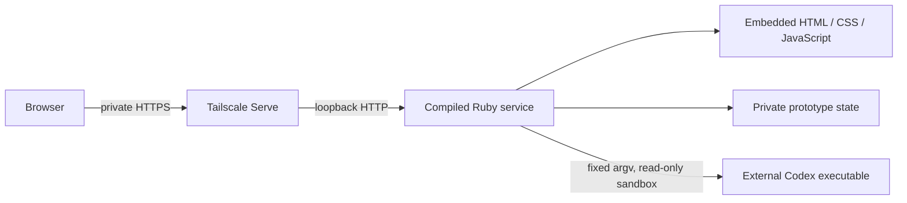

# Ruby web-agent prototype

This is an isolated distribution experiment requested after Card 329. The
operator asked to remove the TUI from the new design, retain Ruby, and prove a
real agent run with secure Tailscale access. The current Tycho entry points,
services, state, dependencies, and planning PR are unchanged.

## What it proves

- A Ruby service and static browser UI can compile together with Spinel.
- The service can start one real Codex task, capture output, stop its process
  group, and retain the latest result after restart.
- Tailscale Serve can provide private HTTPS in front of a loopback listener.
  Every agent API request also requires a separate 256-bit bearer token.
- No ERB, Charm, Bundler, Ruby interpreter, or asset directory is needed by the
  compiled executable. Codex and Tailscale remain external programs.

The service holds a state-directory lock and processes mutations on one event
loop. A worker thread only waits for the child process and returns its exit code.
The pinned Spinel compiler rejects `Process.waitpid2(pid, Process::WNOHANG)`, so
the experiment uses the supported blocking call in that thread.



## Build

Use Spinel commit `3e3653a5520df0b620e9a779d116e83429ec662f`. Read its
[build instructions](https://github.com/matz/spinel/blob/3e3653a5520df0b620e9a779d116e83429ec662f/README.md#quick-start).
Build the toolchain outside this repository. No system-wide installation is
needed. Use a matching Ruby and gem path for build-time generators: this host
had Prism built for Homebrew Ruby and JSON built for mise Ruby in its user gem
directory. The successful compiler build used Homebrew Ruby with an isolated
`GEM_HOME` and the Homebrew system `GEM_PATH`. Do not change the application's
gems to solve a compiler build issue.

From the repository root:

```sh
# CRuby development entry, with embedded assets:
ruby prototypes/spinel_web/build.rb /tmp/tycho-prototype-build

# Native executable, using an already-built pinned compiler:
ruby prototypes/spinel_web/build.rb /tmp/tycho-prototype-build /absolute/path/to/spinel
```

The output directory contains `prototype.rb` and, when compiled,
`tycho-prototype`. The latter can be copied alone. Build-time Ruby is permitted;
it is not a runtime requirement for that executable.

## Start an isolated instance

Create a disposable workspace and a private state directory. Supply absolute
paths. Never use the production Tycho state directory. The parent of the state
directory must already exist. This example uses an empty, dedicated directory:

```sh
mkdir -p /tmp/tycho-prototype-workspace
printf '# Prototype workspace\n' > /tmp/tycho-prototype-workspace/README.md
export TYCHO_PROTO_STATE=/tmp/tycho-prototype-state
export TYCHO_PROTO_WORKSPACE=/tmp/tycho-prototype-workspace
export TYCHO_PROTO_EXECUTABLE=/absolute/path/to/codex
export TYCHO_PROTO_PORT=7483
export TYCHO_PROTO_MODEL=gpt-6.1-sol
export TYCHO_PROTO_ORIGIN=https://YOUR-NODE.YOUR-TAILNET.ts.net:9443
/tmp/tycho-prototype-build/tycho-prototype
```

Use the real DNS name from `tailscale status --json`, without a trailing dot.
For local-only testing, omit `TYCHO_PROTO_ORIGIN`. The local URL is
[loopback prototype](http://127.0.0.1:7483/). For CRuby development, replace the
last command with `ruby /tmp/tycho-prototype-build/prototype.rb`.

The service generates `access-token` inside its mode-0700 state directory. Read
that file locally and enter the value in the page. Do not put the token in a URL,
prompt, screenshot, commit, or PR. It is held only in browser memory and is
cleared by reload. The service checks exact Host and Origin values, JSON content
type, body/header limits, and duplicate/ambiguous request framing. It sends no
CORS permission. Static pages contain no credentials or run data.

Codex must already be authenticated. The command uses `exec`, `--json`,
`--ephemeral`, `--ignore-user-config`, a read-only sandbox, and no interactive
approvals. The prompt is one argv entry, never shell source. The server removes
Ruby/Bundler loader variables, Tycho server tokens, and prototype variables from
the child environment. It does not claim filesystem isolation from other
processes owned by the same host user. Use trusted prompts on this prototype.

## Private HTTPS through Tailscale

Inspect existing routes before adding one. Select an unused HTTPS port. Do not
reset Serve or replace the production port's handler.

```sh
tailscale serve status --json
tailscale serve --bg --https=9443 http://127.0.0.1:7483
tailscale serve status --json
```

Use Serve, not Funnel. Keep the backend bound to loopback. Tailnet access rules
control which devices can connect; the application token separately controls
agent access. This prototype does not modify tailnet rules or authorize requests
from identity headers. It trusts Tailscale for HTTPS and transport, and checks
the application token itself. Verify that `AllowFunnel` is absent or false for
the endpoint. See [Tailscale Serve](https://tailscale.com/docs/features/tailscale-serve)
and the [Serve command reference](https://tailscale.com/docs/reference/tailscale-cli/serve).

To remove only this endpoint:

```sh
tailscale serve --https=9443 off
```

Then send TERM to the recorded prototype server PID. The service stops an active
run before exit. Preserve the state directory if the latest result is needed.
Deleting only the private prototype directory removes its token and saved data.

## Verification

Run the same black-box contract against both runtimes:

```sh
ruby test/spinel_web_prototype_test.rb
TYCHO_PROTO_TEST_BINARY=/absolute/path/to/tycho-prototype ruby test/spinel_web_prototype_test.rb
bin/test
```

The native test sets the server's PATH to `/usr/bin:/bin`. It uses an isolated
shell fixture, not a model call. Checks cover authentication, allowed origins,
rejected hosts, argument injection, secret environment filtering, stdout/stderr,
overlapping runs, failure, process-tree stop including an early-exiting leader,
restart recovery, static assets, and ambiguous HTTP framing.

For the actual browser/model gate, install Playwright into a temporary directory
with `npm install --prefix /tmp/tycho-prototype-browser --ignore-scripts --no-audit playwright`.
Use an installed Chrome; no browser download is required. Start the service with
Codex, then run:

```sh
NODE_PATH=/tmp/tycho-prototype-browser/node_modules \
CHROME_PATH='/Applications/Google Chrome.app/Contents/MacOS/Google Chrome' \
TYCHO_PROTO_TEST_URL=https://YOUR-NODE.YOUR-TAILNET.ts.net:9443 \
TYCHO_PROTO_TEST_TOKEN_FILE=/tmp/tycho-prototype-state/access-token \
TYCHO_PROTO_CAPTURE_DIR=/tmp/tycho-prototype-captures \
node prototypes/spinel_web/browser-smoke.cjs
```

This makes one real model call. It checks a wrong token, successful login, real
agent output, draft retention during polling, desktop/mobile layout, script
errors, and token loss after reload. Captures exclude the token.
The harness contract follows the installed Codex CLI help and
[Codex non-interactive mode](https://developers.openai.com/codex/noninteractive).

### Initial observed result

On macOS 15.8.1 ARM64, the pinned compiler produced a 791,264-byte executable.
`otool -L` listed only `/usr/lib/libSystem.B.dylib`; its encoded deployment target
was macOS 15.0. That target is metadata, not a tested minimum-OS claim.
The seven contract checks passed under CRuby and the compiled executable.
They also passed after copying only the binary to a read-only directory with
spaces and Japanese characters in its name and restricting PATH.

Chrome successfully used the Tailscale HTTPS endpoint with normal certificate
validation. An unauthenticated API request returned 401. A real Codex 0.160.0
agent using `gpt-6.1-sol` read the disposable workspace's README with a command
tool and returned its heading plus the requested success marker. Desktop and
390-pixel mobile captures passed, with no script errors or horizontal overflow.
The original Tailscale routes and the workspace file were unchanged.

## Limits and next gates

- Only one active run and the latest saved result. No sessions, delegation,
  scheduler, queue, migration, updater, or production configuration integration.
- Codex runs for at most about three minutes, plus request/stop latency. Output
  over 1 MiB requests cancellation; only the first 64 KiB is returned. This is
  polling-based protection, not a disk quota.
- State uses flush/fsync plus atomic rename. Directory fsync and power-loss
  recovery are not qualified. Corrupt state fails startup instead of being
  silently discarded.
- A hard server kill marks an unfinished saved run `interrupted` on restart. It
  does not adopt or kill a PID from disk. A child can outlive such a crash; host
  process supervision is still required for that case. Stop controls the original
  process group, not children that deliberately create a different session.
- HTTP is a small strict prototype parser, not a qualified general web server.
  It handles one request at a time, limits request reads to three seconds, and
  closes each connection. Independent security review and load/backpressure
  tests are required before production use.
- The initial evidence is macOS ARM64 only. Tailscale HTTPS was tested from the
  same host through the tailnet URL; another authorized device and denied-device
  ACL tests remain. No new native Windows, Intel, Linux, minimum-OS, signing, or
  clean-machine support claim follows from this result.
- Preserve CRuby as a behavior reference. Repeat native tests after every Spinel
  revision. A successful compile alone is not a compatibility test.

Next: independently review the HTTP/process boundaries, test from a second
tailnet device, qualify an otherwise clean target host, and add a Linux lane.
Only then decide whether to port more Tycho behavior.
